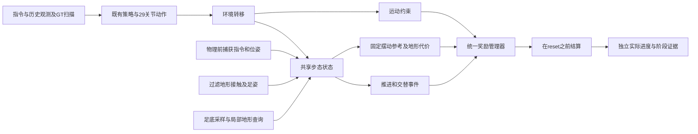

# H2walk 算法与奖励架构重设计

日期：2026-11-04。父提交：`0fc7722abf6f464041f26697bcb1dc3dfba069bf`。研究依据与证据等级见 [调研报告](H2walk奖励函数调研报告.md)。本轮交付源码、CPU 性质验证和独立审查，没有启动训练、仿真或真机，也没有读取保存权重、pkl 或执行优化器更新。

## 1. 目标、取舍与整体数据流

目标仍是同一策略在普通地形正常交替行走，并兼顾上楼和下楼。旧方案已有有符号实际位移与交替落脚，但叠加39个非零权重项：同一速度目标多次计分，实际摆腿又受到脚速、脚加速度、固定时长等代价约束；nearest 只保持上楼 Z，支撑主要检查接触和单点高度。本轮把这些职责拆成四组，关闭重复项，默认使用 `terrain_v2`。

沿用固定缩放、无RND的 PPO 与 `H2ActorCriticOur`，29个关节位置动作、5帧历史及561点GT扫描、原有终止条件。没有论文证据支持此时重写PPO或添加步频动作，故这轮重设计集中在感知到奖励的数据流、步态状态、目标生命周期、奖励组合及阶段协议。它是新的可训练算法配置，尚无新训练结果。



职责划分：

| 模块 | 职责 |
| --- | --- |
| `terrain_gait.py` | 纯张量足底样点、有限近邻高度、覆盖代理、落脚候选及摆动高度参考 |
| `walking_rewards.py` | 复用的执行指令捕获、有符号位移、连续对侧支撑和交替落脚；旧模式默认数值不变 |
| `terrain_walking_rewards.py` | 新模式共享状态、离地锁定、覆盖门槛、摆动评分、支撑和落地代价 |
| `mdp/rewards.py` | 薄奖励适配器，共享一次状态结算；不各自维护一套相位 |
| `walking_profiles.py` | 22项完整预算、六阶段共用权重、版本与配置一致性检查 |
| `walking_env_cfg.py` / `robot_env.py` | 任务接线、物理前/奖励阶段/reset生命周期 |
| `train_walk.py` / `walk_protocol.py` | 显式选择模式、配置指纹、同协议恢复和跨模式拒绝 |

这些文件位于 `source/CtrlLab/CtrlLab/tasks/manager_based/h2_task/`，训练入口位于仓库 `tools/`。原 Stairs/Rough/Flat 仍保持各自旧配置。

## 2. 四组奖励：22项完整预算

奖励管理器按照 \(r_t=\Delta t\sum_k w_k f_k\) 求和，默认控制步长0.02 s。连续项是奖励率；交替、落地和失败项返回事件量除以控制步长，因此每次事件积分不随步长变化。这里的权重是本项目待验证的新实验预算，不是从论文复制的H2成功配方。

| 分组 | 配置项 | 权重 | 含义 |
| --- | --- | ---: | --- |
| 任务 | `track_lin_vel_xy` | +3 | 现有宽/窄带混合的指令平面速度跟踪 |
| 任务 | `track_ang_vel_z` | +1 | 偏航角速度跟踪 |
| 任务 | `walk_signed_progress` | +1 | 执行指令方向的实际有符号位移率 |
| 步态 | `walk_alternating_steps` | +0.5 | 满足净推进、时间、对侧连续支撑及覆盖要求的交替落脚事件 |
| 地形 | `terrain_walk_swing` | +0.75 | 实际向前摆动时跟踪锁定的地形相对高度参考 |
| 地形 | `terrain_walk_support` | −1 | 接触与支撑不一致、支撑脚覆盖不足、无支撑代价 |
| 地形 | `terrain_walk_landing` | −0.25 | 首次落地过大竖向载荷事件 |
| 约束 | `terrain_walk_failure` | −2 | 非纯超时失败，每次事件−2 |
| 约束 | `flat_orientation` | −4 | 投影重力水平分量平方，保持躯干竖直 |
| 约束 | `base_angular_velocity` | −0.05 | 横滚/俯仰角速度平方 |
| 约束 | `joint_acc` | −2.5×10⁻⁷ | 关节加速度平方 |
| 约束 | `joint_power` | −1×10⁻⁴ | 各关节绝对机械功率之和 |
| 约束 | `action_rate` | −0.02 | 相邻原始动作差平方 |
| 约束 | `joint_waist_deviation` | −0.5 | 腰部默认姿态偏离平方 |
| 约束 | `joint_arm_deviation` | −0.1 | 手臂默认姿态偏离平方 |
| 约束 | `dof_pos_limits` | −10 | 软关节位置限位 |
| 约束 | `dof_vel_limits` | −1 | 软速度限位，soft ratio 0.75 |
| 约束 | `dof_tor_limits` | −1 | 按关节扭矩限制的超额量，soft ratio 0.75 |
| 地形 | `feet_slide` | −0.5 | 接触脚水平滑动速度 |
| 地形 | `feet_stumble` | −1.5 | 同一个接触采样中横向力大于竖向力5倍 |
| 约束 | `undesired_contacts` | −2 | 不希望出现的身体接触 |
| 约束 | `fall_body_contacts` | −12 | 躯干/骨盆等摔倒相关接触 |

其余继承的旧奖励项全部为0或禁用，包括重复的 `track_forward_progress`、额外垂直速度/侧向速度/加速度/躯干高度、关节速度/力矩平方/功率方差、二阶动作差、腿部姿态、固定空中/接触时长及方差、空中脚速/总脚速/脚加速度、旧净空/抬脚/楼梯高度、总支撑力和静止姿态奖励；旧 `walk_support_quality` 也由新支撑项替换。没有把这些名称改挂到新公式下。

既有接触约束可能在同一接触上同时触发 `undesired_contacts`、`fall_body_contacts`，失败项则在终止时另收一次代价。这是显式的运动约束预算，不将它们解释为互斥事件。原终止条件仍可能把净接触触发判为失败；过滤地形接触诊断继续提供来源证据，本轮没有声称解决所有物理后端或自碰来源问题。

## 3. 实际推进与合格交替

执行本次动作前捕获根位置、机体yaw和速度指令，奖励阶段用实际位移计算：

\[
f_{progress}=\frac{(x_{t+1}-x_t)\cdot\hat d_t}{\max(\|c_{xy,t}\|,0.1)\Delta t}.
\]

只有有限有效指令且速度至少0.1 m/s才启用；超过5 m/s上限的转移视为位置异常。没有正值截断、支撑门控或逐步饱和；相同指令下等量前后位移会抵消。初始悬空不能启动步态周期；两脚同时离开支撑、对侧支撑中断、通道无效或指令方向改变会撤销该周期资格。

交替事件要求：离地至少0.08 s且不超过1.2 s、摆动脚沿捕获方向前进至少0.04 m、身体前进至少0.01 m、超过已经记过奖的净推进前沿、与上次记奖脚不同、同时只有一只合格脚落地。新模式再要求落地18个足底点全部可查询，且至少60%满足近地面条件。覆盖只约束落地事件，不强制对侧脚在整个支撑期保持宽覆盖，允许正常脚滚动与蹬离。

## 4. 足底几何与统一上下楼参考

每只脚使用底面内部6×3个样点，左脚局部X为−0.05到0.135 m、Y为0.025/0.038/0.052 m，右脚镜像Y，底面Z约−0.0543 m。使用完整足部世界四元数变换；这些点是底面内部采样，不能当完整边界或实际面积积分。

每点只取水平距离0.04 m以内最近的有限GT ray。未知保持未知，不补世界高度0；点与地形Z差绝对值不超过0.015 m视作近表面。全脚查询有效性与近表面比例分别保留。现有扫描间距5 cm，因此这个比例只提供几何代理，不能证明全足底承载、CoP、摩擦、台阶边缘毫米级裕度或动态稳定。

候选着陆踝link的XY沿指令方向向前0.16/0.20/0.24/0.28/0.32/0.36/0.40 m，保留脚yaw，假设着陆底面水平；Z表示足底高度。选择最近的全部样点可查询、地形高度差不超过0.015 m、起落高度差不超过±0.24 m的候选。路径观察到超过起脚高度0.24 m的障碍会拒绝候选，不能跳过近处高障碍去奖励远处低面。该检查无法识别没有被5 cm网格采到的孔洞，不能称为碰撞自由或运动学可达规划。

最后一个合格支撑帧保存候选；离地时锁定起点、落点和路径最高点，空中不重新选择。高度顶点为 \(z_A=\max(z_0,z_1,z_{path})+0.035\)。用实际脚水平位移沿起落方向投影得到 \(u\in[0,1]\)，再以分段smoothstep构造起点→顶点→落点的C1连续高度参考。下楼 \(z_1<z_0\)，参考末端会下降到低踏面，不持续要求脚停在高台面上。

摆动评分为 \(\exp[-((z_{sole}-z_{ref})/0.05)^2]\)，只在有合法周期、对侧连续支撑、水平向前运动速度大于0.02 m/s和有效目标时计分，两脚取均值。静态举腿、竖直抬脚、初始空中、跳跃和超时摆动不能凭该项持续拿分。XY端点用于高度相位和目标保持，本轮没有逐坐标模仿论文的3D轨迹跟踪，也没有把奖励参考作为关节控制器直接执行。

支撑成本由三部分相加：两脚原始接触而无合格地面支撑或通道无效的比例；支撑脚采样覆盖缺口的两脚均值（查询未知按缺口1）；两脚都没有合格支撑时的1。竖直支撑来自过滤地形接触力与局部近表面检查，横向碰立面不能当上向支撑。

落地成本采用首次合格支撑时 \(\min([F_z/(mg)-1]_+^2,25)/\Delta t\)，按落地脚求和。它是离散传感器上的过载代理，尚未验证真实力峰值、采样混叠或冲量；不能据此承诺软着陆。

## 5. 生命周期、兼容与旧权重

顺序固定为物理前捕获→RewardManager内结算一次→终止奖励→终止证据→reset清理。多个奖励适配器共用同一次状态结果，reset瞬移不计推进；部分reset只清对应环境行，异常则清理待结算状态并继续抛出错误。

`terrain_v2` 的奖励版本为 `h2_walk_rewards_v2`；旧 `legacy` / `alternating_v1` 保留 `h2_walk_rewards_v1`。固定缩放协议仍叫 `h2_walk_fixed_scales_v2`，观测/动作布局没变。mode、奖励版本、全部resolved奖励函数/参数/权重、新几何常数及支撑阈值都进入配置指纹。同模式同协议可跨地形阶段恢复；跨奖励模式或参数改变必须拒绝。旧归一化/RND/未知marker的权重继续拒绝。

旧权重保留在原目录，与原配置及代码版本一起作为对照档案；不要删除、覆盖、改marker、丢掉normalizer或强行载入新模式。新模式从Bootstrap零起步。旧模式若要复现实验，显式选择对应mode，且仍需通过原有同协议检查。

## 6. 训练命令与阶段方法（仅说明，未执行）

在具备项目Isaac Lab资产与 RSL-RL 2.3.3 的环境中：

```bash
python tools/train_walk.py --task Unitree-H2-Velocity-Walk-Bootstrap \
  --reward_mode terrain_v2 --cross_time_mode bounded \
  --num_envs 1024 --max_iterations 8000 --save_interval 100 \
  --seed 42 --run_name bootstrap_terrain_v2 --device cuda:0 --headless
```

不传checkpoint表示从零开始，8000轮只是预算。其后按 Bootstrap→Shallow(2–5 cm)→Stairs08(5–8)→Stairs12(8–12)→Stairs16(12–16)→Stairs20(固定20 cm)；每个楼梯阶段保留6列平地、2列上楼、2列下楼，奖励始终相同。达到验收后，结束当前过程，再显式选择下一任务和已验收的同模式checkpoint：

```bash
python tools/train_walk.py --task Unitree-H2-Velocity-Walk-Shallow \
  --checkpoint "/actual/bootstrap-run/model_7999.pt" \
  --expected_completed_iterations 8000 \
  --reward_mode terrain_v2 --cross_time_mode bounded \
  --num_envs 1024 --max_iterations 8000 --save_interval 100 \
  --seed 42 --run_name shallow_terrain_v2 --device cuda:0 --headless
```

路径和迭代数必须替换为实际值；`max_iterations` 是本次追加预算，不能用文件名冒充已完成轮数。阶段建议不是自动升级，不能在一个正在运行的环境中热替换地形。

## 7. 验收与待动态验证项

CPU验收检查张量公式、世界坐标等变、未知扫描、穿透/悬边、上下落点、锁定/释放、无目标空中不补采、静止/跳跃无摆动正分、交替及净推进、事件dt积分、部分reset/异常和协议拒绝。测试数量与审查结果记录在 [验证记录](验证记录.md)，CPU通过只支持实现性质。

实际阶段验收沿用独立的实际进度与高度证据，不用总回报替代成功率：每个必需地形组至少32个自然回合，成功率至少80%，失败计入分母；Bootstrap只需平地组。要求接近完整20 s而未失败、有效前进指令至少2 s、目标距离至少0.5 m、有符号实际/目标距离比0.8–1.2、扣除非指令位移后的有效比例至少0.8、不出原tile且数据有效。上下楼还要求双脚分别形成至少两次新的方向一致的踏面高度记录，最终净高度正确。

训练中的滚动窗口建议不能替代冻结checkpoint的独立评估。未来获准动态验证时，还需检查完整多步交替、每脚落地采样覆盖、真实支撑/自碰来源、下楼受控落地、碰撞与力峰值、平地和上下楼逐组视频及多种随机种子。当前分支没有受审的冻结策略评估CLI，不能捏造 `--play` 或用零轮训练作为评估。

在保持模式和协议不变的条件下，可以用旧两种模式做独立从零对照；新模式内部再改预算或几何参数时形成新指纹，重新开始对应实验。当前阶段不混入push、DR、延迟、观测噪声和扩速，以免同时改变多项条件。更一般斜坡/碎石/障碍、GPU吞吐、真实过滤接触API、足部候选可达性和学习收敛仍待验证；本轮不宣称达到这些能力。
